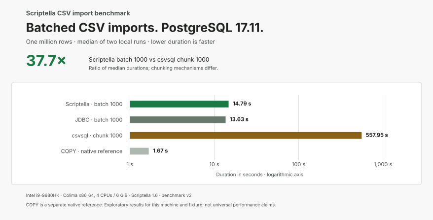
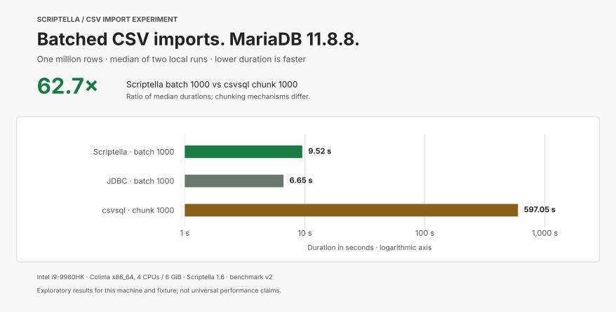

# Scriptella benchmarks

An exploratory experiment comparing CSV imports with Scriptella, handwritten
JDBC, and csvsql, with PostgreSQL native COPY as a separate reference. The fixed eleven-case comparison runs on
PostgreSQL and MariaDB, and compatible repeated runs can be aggregated.

## Published local results

[Two local runs on an Intel i9 / Colima machine](docs/results/2026-10-12-intel-i9/README.md)
include unchanged measurements, dependency metadata, individual values, medians,
and coarse RAM observations. These are exploratory results for that workload and
machine, not universal performance claims.

With **Scriptella 1.6 batch size 1000**, one million rows took a median of
**14.79 s on PostgreSQL** and **9.52 s on MariaDB**. csvsql chunk 1000 took
557.95 s and 597.05 s, respectively: Scriptella was **37.7× and 62.7× faster**
in these two local runs. Handwritten JDBC batching remained faster than Scriptella,
at 13.63 s and 6.65 s. Chunking and JDBC batching use different mechanisms.

Coarse first-run MariaDB memory observations were about **188 MiB for batched
Scriptella** and **895 MiB for csvsql**. These are sampled process-memory
observations, not precise RAM benchmarks. The detailed report also includes
unbatched cases and PostgreSQL's native COPY reference.





## Run the comparison

Clone the repository and enter its directory:

```sh
git clone https://github.com/scriptella/scriptella-benchmarks.git
cd scriptella-benchmarks
```

The host needs a Docker-compatible runtime and Docker Compose. The image owns
Java 17, Maven, Python/csvkit, the selected Maven-published Scriptella release,
and JDBC dependencies. It does not use a Scriptella source checkout or distribution ZIP.

```sh
ENVIRONMENT_ID=my-machine-docker \
ENVIRONMENT_DESCRIPTION='Describe CPU, architecture and Docker runtime' \
SCRIPTELLA_VERSION=1.6 docker compose up --build \
  --abort-on-container-exit --exit-code-from benchmark
```

This starts PostgreSQL 17.11 and MariaDB 11.8.8, waits for health checks,
generates one deterministic million-row CSV, verifies the requested Scriptella
artifact versions and their SHA-256 checksums, and prepares each database. It
inserts and verifies the first, middle, and last fixture values using typed
JDBC bindings, then truncates the table and verifies it is empty. Preparation
is followed by the eleven-case comparison described below. Results and diagnostics
are saved under `results/run-<timestamp>-<id>/`:

- `measurements.csv`: only successfully imported and independently verified cases.
- `preparation.properties`: environment, resolved dependency versions/checksums,
  fixture details, database settings, phase, and final success/failure status.
- Per-case smoke, warmup, and measured process logs.

On failure, the command exits nonzero and keeps completed valid measurements and
diagnostics. Future measurements record the stable `benchmark_version=v2`
compatibility identifier. Repeated runs of an unchanged benchmark do not require
Git commits. Increment the version when meaningful implementation or methodology
changes affect comparability, such as timing boundaries, conversions, transaction
behavior, or case order. Other environment, fixture, dependency and case metadata
must still match when aggregating.

`BENCHMARK_REVISION` is optional build-time traceability metadata (default `n/a`),
and does not determine compatibility. You may supply a Git SHA; mark a modified
checkout's traceability value as dirty rather than presenting it as a clean
commit. Existing raw measurements retain their original schema and revision
markers. Unversioned legacy runs require an explicit documented compatibility
attribution outside the raw files before inclusion in a versioned aggregate.

To perform only preparation, add `BENCHMARK_COMMAND=prepare` to the Compose
command. Use `BENCHMARK_COMMAND=smoke` to validate all eleven imports with
2,001-row prefixes (including a final partial batch), without recording timings.
Their directories are labeled `preparation-...` or `smoke-...` and contain no
`measurements.csv`. The fixture stays inside the stopped benchmark container.

Credentials are disposable, databases have no host ports, and no persistent
database volumes are configured. Remove stopped containers and their anonymous
database volumes after inspection:

```sh
docker compose down --volumes
```

For another run, use `docker compose up --build --force-recreate` with the same
exit flags. Each run gets its own directory.

## Fixture and schema

The CSV has header `id,name,category,amount,created_at`, UTF-8 encoding, LF
line endings, and exactly 1,000,000 rows. For row `i`, values are `i`,
`row_<i>`, `category_<i % 10>`, `(i % 100000)` integer cents rendered with
two decimal places, and `2020-01-01 00:00:00` plus `i` seconds. Timestamps are
timezone-free, whole-second values; clients and database sessions use UTC.
There are no nulls, transformations, indexes, or primary keys.

The table uses BIGINT, VARCHAR(32), VARCHAR(16), DECIMAL(12,2), and PostgreSQL
TIMESTAMP WITHOUT TIME ZONE or MariaDB DATETIME. All columns are NOT NULL;
MariaDB uses InnoDB. Durability settings and JDBC batch options retain normal
defaults. Preparation records server versions and selected durability settings.

## Measurement method

Every run first smoke-checks all eleven cases. For each database, the fixed
order is Scriptella unbatched, Scriptella batch 1000, JDBC unbatched, JDBC batch
1000, then csvsql chunk 1000, then PostgreSQL native COPY reference on PostgreSQL
only; PostgreSQL runs before MariaDB. Each case uses one transaction and one
commit per import, the same JDBC URL/driver defaults, and a pre-created table.
There are no driver batch option overrides. In the pinned driver sources,
pgJDBC defaults `reWriteBatchedInserts=false`; MariaDB defaults
`useBulkStmts=false` and `useBulkStmtsForInserts=true`. Both implementations
inherit those same settings. JDBC uses Apache Commons CSV 1.14.1,
independent of Scriptella. Scriptella uses explicit `format.<column>.*` conversion
rules returning Long, BigDecimal and Timestamp; custom formatters also require
a `type` property to enable conversion. Both paths preserve integer IDs,
exact decimal cents, and whole-second timestamps.

Timing includes fresh client process startup through successful
exit after commit and cleanup, excluding fixture generation, database startup,
warmup, reset, and verification. A fixed 20,000-row untimed warmup precedes each
measured case, followed by table reset. It primes database and file caches; it
does not warm the fresh measured JVM's JIT. Heap and garbage collector selection
use JVM defaults; every Java process uses `-Duser.timezone=UTC`.

After each import exits, a separate connection checks row count and first,
middle, and last IDs, strings, decimals and timestamps. The runner then writes
duration and throughput and resets the table. Console ratios use current-run
durations: Scriptella vs JDBC is `JDBC / Scriptella` for each matching mode;
batching speedup is `unbatched / batch-1000` for each implementation;
Scriptella vs csvsql is `csvsql / Scriptella` for each Scriptella mode;
COPY vs Scriptella is `Scriptella / COPY`. Above 1
means the first named implementation or batched mode is faster.

csvsql 2.2.0 uses the [documented direct-import workflow](https://csvkit.readthedocs.io/en/2.2.0/scripts/csvsql.html):
`csvsql --db <SQLAlchemy URL> --tables csv_import --no-create --insert --chunk-size 1000 <fixture>`.
Type inference, dialect sniffing, SQLAlchemy and DBAPI settings use normal defaults.
Chunk 1000 aligns row grouping with JDBC batching; it is not an optimal-size claim.
The image pins SQLAlchemy 2.0.46, psycopg2-binary 2.9.11 and PyMySQL 1.1.2.
Python package versions and invocation are recorded in run metadata. Python/csvkit
startup is included in csvsql timing. COPY streams the same CSV through pgJDBC,
with explicit columns and CSV/header/UTF-8 settings, in one transaction.

## Aggregate compatible runs

Place two or three compatible run directories under one results directory, then:

```sh
docker compose run --no-deps --rm benchmark aggregate /results
```

The command writes `/results/report.md`, including median duration, median
throughput, every individual measurement and ratios of median durations.
It scans recursively and rejects incompatible metadata, duplicate run/case rows,
invalid timings and legacy files missing compatibility fields. Select compatible
runs in a separate directory if `/results` also contains older experiments; use:

```sh
docker compose run --no-deps --rm \
  -v /absolute/path/to/selected-runs:/results benchmark aggregate /results
```

To regenerate the published local report with the benchmark image:

```sh
docker compose run --build --no-deps --rm \
  -v "$PWD/docs/results/2026-10-12-intel-i9:/results" benchmark aggregate /results
```
Scriptella releases remain separate; Git revision is traceability only.
Partial runs contribute only verified cases; comparisons with missing cases are omitted.
The report records sample counts so incomplete comparisons remain visible.

Version v2 adds csvsql and COPY and changes case order. Existing v1 and legacy
raw results stay unchanged and cannot be silently pooled with v2.
## GitHub Actions

Use **Actions → CSV import benchmark → Run workflow**, with the numeric
Maven-published `scriptella_version` input (default `1.6`). The manual workflow
runs the same full Compose experiment on `ubuntu-24.04`, generates a single-run
report, and uploads measurements and diagnostics as a downloadable artifact.
Completed measurements and logs are uploaded even if a later case fails.
Artifacts are retained for 30 days. The runner needs no project secrets.

CI establishes reproducibility and catches breakage. GitHub-hosted machines vary;
an environment ID or matching runner label does not prove identical hardware.
Keep CI numbers separate from named-machine runs and avoid presenting independent
hosted executions as precise performance comparisons.

## Expected duration and resource use

The published million-row local runs took about 33–35 minutes each. Runtime varies
by machine and Docker allocation; csvsql spent about 9–10 minutes per database in
these runs. Its normal type-inference path loads an in-memory table before
inserting, so a quiet console can mean parsing rather than a stalled import.
The runner prints each stage and retains subprocess logs. It has no progress
percentage. Preparation and smoke-only runs offer a short correctness check.

The experiment does not routinely profile RAM. Published memory observations are
coarse process resident-memory diagnostics from part of the first local run,
with their collection method and limits documented alongside the results.

This is a directional engineering experiment, not an industry-grade benchmark.
Machine, Docker environment, runtime and database versions, caches, fixed case
order, and startup overhead affect results. Repeated compatible runs help
interpret a result; they do not make it universal. csvsql chunking differs from
JDBC batching. PostgreSQL COPY is a native reference, not a portable competitor.
