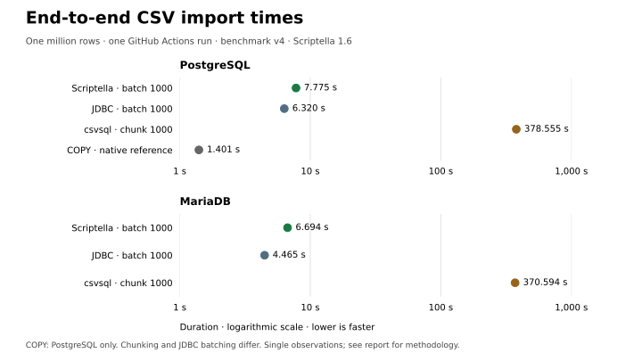

# Scriptella benchmarks

[Scriptella](https://github.com/scriptella/scriptella-etl) is a Java ETL tool that describes data
flows in XML and SQL. This experiment compares its end-to-end CSV import times
with handwritten JDBC, csvsql, and PostgreSQL's native COPY.

The reproducible eleven-case comparison imports one million rows into
PostgreSQL and MariaDB. This repository includes the implementations, raw
measurements, independent import verification, and Docker Compose setup.

## Why this comparison?

The goal is to establish a reproducible performance baseline for Scriptella
and guide future improvements, starting with a simple CSV import workload.

- **Scriptella:** declarative CSV parsing and SQL inserts, with and without batching.
- **Handwritten JDBC:** a Java baseline using the same database drivers,
  with Apache Commons CSV for parsing and explicit typed bindings.
- **csvsql:** the documented CSV-to-SQL command-line workflow from Python's csvkit.
- **PostgreSQL COPY:** a native bulk-loading reference for direct CSV imports.

These are specific workflows and settings, not a ranking of CSV loaders.
No transformations or MariaDB native loader are tested.

## Benchmark v4

The current benchmark definition is **v4**: PostgreSQL explicitly enables
`reWriteBatchedInserts=true` for both Scriptella and handwritten JDBC. This
change follows the [repeated local follow-up](docs/results/2026-10-21-pg-rewrite/README.md).
The fixture, batch size, transaction boundaries and verification are unchanged.
MariaDB retains its driver defaults. Scriptella's general adapter default is
unchanged. Keep v4 measurements separate from v3 and the false/true follow-up dataset.

## Current v4 results

One complete [GitHub Actions run](https://github.com/scriptella/scriptella-benchmarks/actions/runs/39688830534)
on 2026-10-21 imported one million rows with Scriptella 1.6 on Ubuntu 24.04:

| Database | Scriptella batch 1000 | JDBC batch 1000 | csvsql chunk 1000 | Native COPY reference |
|---|---:|---:|---:|---:|
| PostgreSQL | 7.775 s | 6.320 s | 378.555 s | 1.401 s |
| MariaDB | 6.694 s | 4.465 s | 370.594 s | N/A |



Handwritten JDBC batching was faster than Scriptella; both took less time than
csvsql's chunk-1000 import path. Native COPY was fastest on PostgreSQL.
Chunking and JDBC batching use different mechanisms.

The [full v4 report and evidence](docs/results/2026-10-21-ci-v4/README.md)
include all eleven cases, unbatched results, and dependency metadata.
Each import passed independent row-count and sample-value verification before
its timing was recorded. These are single observations from one run; CI did
not measure RAM. Different GitHub-hosted runners do not establish a controlled
comparison with historical runs.

## Reproduce

You need Git, a Docker-compatible runtime, and Docker Compose. The container
build supplies Java, Maven, Python/csvkit, Scriptella, and JDBC dependencies;
a Scriptella source checkout or distribution ZIP is not required.

Clone this repository and enter it:

```sh
git clone https://github.com/scriptella/scriptella-benchmarks.git
cd scriptella-benchmarks
```

First, smoke-test all eleven imports with 2,001-row prefixes, including a final
partial batch. This checks correctness without recording benchmark timings.
The first invocation also downloads images and builds the benchmark image.

```sh
BENCHMARK_COMMAND=smoke SCRIPTELLA_VERSION=1.6 docker compose up --build \
  --abort-on-container-exit --exit-code-from benchmark
```

Run the full million-row comparison with a description of your environment:

```sh
ENVIRONMENT_ID=my-machine-docker \
ENVIRONMENT_DESCRIPTION='Describe CPU, architecture and Docker runtime' \
SCRIPTELLA_VERSION=1.6 docker compose up --build --force-recreate \
  --abort-on-container-exit --exit-code-from benchmark
```

The historical local runs took about 33–35 minutes each; runtime varies by
machine and Docker allocation. Results and diagnostics are saved under
`results/run-<timestamp>-<id>/`. The command exits nonzero on failure and retains
completed valid measurements and diagnostics.

See the [benchmark guide](docs/benchmark-guide.md) for output files, cleanup,
configuration, aggregation, and the complete measurement method.

## Limitations

These are end-to-end workflow timings, including process startup, CSV parsing,
type conversion, database writes, and commit. Different parsers, conversion
paths, and startup work mean they do not isolate Scriptella's abstraction
overhead. This is a single workload; hardware, caches,
driver defaults, and fixed case order affect results. Compare implementations
within a run. Use repeated runs on a controlled machine to measure changes
over time, and keep different benchmark versions and environments separate.

## Further reading

- [Benchmark guide](docs/benchmark-guide.md): fixture, schema, timing boundaries,
  driver settings, verification, compatibility rules, and operational details.
- [Scriptella ETL example and full benchmark configuration](docs/scriptella-etl.md).
- [Historical v3 CI results](docs/results/2026-10-14-ci-v3/README.md):
  one complete run before PostgreSQL batch rewriting was enabled.
- [Historical v2 local results](docs/results/2026-10-12-local/README.md):
  two runs, charts, and coarse process-memory observations.
- [Historical v2 CI results](docs/results/2026-10-13-ci/README.md):
  one complete run with measurements and dependency metadata.
- [Importing a million CSV rows: Scriptella, JDBC, csvsql, and PostgreSQL COPY](https://pvrlabs.xyz/articles/importing-a-million-csv-rows.html):
  the PVR Labs article walking through the historical v2 results.

## PostgreSQL batch rewrite follow-up

A separate [three-round follow-up](docs/results/2026-10-21-pg-rewrite/README.md)
compares pgJDBC `reWriteBatchedInserts=false` and `true` at batch size 1000,
using Scriptella 1.6 and handwritten JDBC, with current MariaDB controls.
It retains the v3 fixture, transactions and verification. These measurements
use a separate compatibility identifier and do not replace the v3 results.
