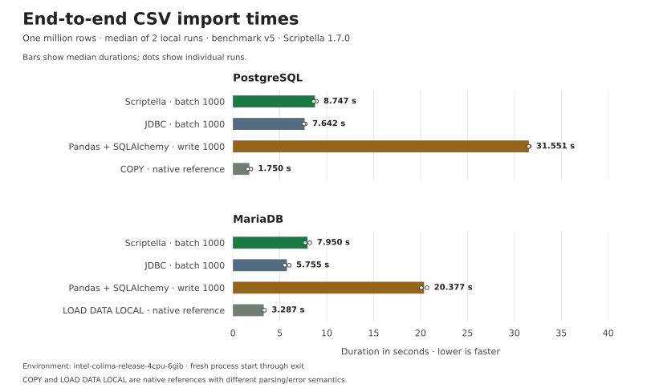
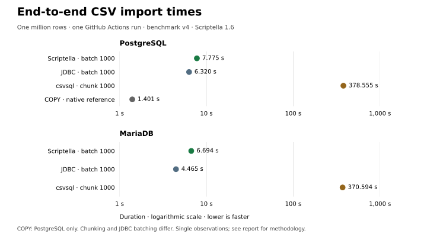

# Scriptella benchmarks

[Scriptella](https://github.com/scriptella/scriptella-etl) is a Java ETL tool that describes data
flows in XML and SQL. This experiment compares its end-to-end CSV import times
with handwritten JDBC, Pandas + SQLAlchemy, and native database loaders.

The reproducible eight-case comparison imports one million rows into
PostgreSQL and MariaDB. This repository includes the implementations, raw
measurements, independent import verification, and Docker Compose setup.

## Why this comparison?

The goal is to establish a reproducible performance baseline for Scriptella
and guide future improvements, starting with a simple CSV import workload.

- **Scriptella:** declarative CSV parsing and SQL inserts, batch size 1000.
- **Handwritten JDBC:** a Java baseline using the same database drivers,
  with Apache Commons CSV for parsing and explicit typed bindings, batch size 1000.
- **Pandas + SQLAlchemy:** explicit typed CSV chunks inserted in one transaction.
- **Native references:** PostgreSQL COPY and MariaDB LOAD DATA LOCAL INFILE.

These are specific workflows and settings, not a ranking of CSV loaders.
No transformations or database-to-database transfers are tested.

## Benchmark v5

V5 replaces csvsql with Pandas + SQLAlchemy using 10,000-row CSV chunks and
1,000-row inserts, preserving the v4 fixture, schema, transaction boundaries,
warmup and independent verification. PostgreSQL retains
`reWriteBatchedInserts=true` for both Java implementations. The final eight cases
include six portable workflows and two native bulk-loading references.
MariaDB LOCAL INFILE streams the same client-side fixture without copying it
into the database container. Native loaders have different parsing/error
semantics; see the [guide](docs/benchmark-guide.md#mariadb-native-load-data).
Unbatched Scriptella/JDBC are retired: batching is the established baseline for
this workload. There are no unbatched opt-in execution modes.
Keep final eight-case measurements separate from earlier seven-/eleven-case v5
experiments and historical v4 results; their case definitions are incompatible.

See the [contender registry](docs/contenders.md) for lifecycle decisions.
Pandas is retained as a familiar portable reference following the v5 spike;
the final measurements are summarized below. No v5 performance claims are based
on historical v4 measurements.

## Current v5 results

Two complete local runs on an Intel Mac with Colima x86_64 (4 CPUs, 6 GiB)
imported one million rows through all eight cases using Scriptella 1.7.0 on
2026-11-03. That VM size is the local reference setup for quoted comparisons.



| Database | Scriptella batch 1000 | JDBC batch 1000 | Pandas + SQLAlchemy | Native reference |
|---|---:|---:|---:|---:|
| PostgreSQL | 8.747 s | 7.642 s | 31.551 s | COPY: 1.750 s |
| MariaDB | 7.950 s | 5.755 s | 20.377 s | LOAD DATA LOCAL: 3.287 s |

Pandas took 3.61× and 2.56× Scriptella's time on PostgreSQL and MariaDB,
respectively. JDBC was faster than Scriptella in both databases. Native loaders
were fastest here and remain separate references with different parsing and
error semantics. Every import passed independent row-count and sample-value checks.

The [v5 report, individual measurements and reproduction instructions](docs/results/2026-11-03-local-v5/README.md)
include dependency metadata and limitations. These are two observations on one
local environment; no RAM measurements were taken. Historical CI results below
come from a different environment and are not a controlled comparison with v5.
Earlier Scriptella 1.6 runs on a VM of this size remain in
[2026-10-26-local-v5](docs/results/2026-10-26-local-v5/README.md).

## Scriptella 1.6 and 1.7.0

Four full v5 runs on the same 4-CPU, 6 GiB VM compared published Scriptella 1.6
and 1.7.0: two runs per version in the order 1.6, 1.7.0, 1.7.0, 1.6. The table
reports the median of the two Scriptella runs for each database; the individual
values are shown in parentheses.

| Database | Scriptella 1.6 | Scriptella 1.7.0 | Change in duration |
|---|---:|---:|---:|
| PostgreSQL | 14.604 s (13.603, 15.605) | 8.747 s (8.893, 8.601) | -40.1% |
| MariaDB | 11.217 s (12.567, 9.867) | 7.950 s (8.200, 7.700) | -29.1% |

Every import passed independent row-count and sample-value verification.
Scriptella 1.7.0 was faster on both databases, and the runs did not overlap.
With only two observations per release, the percentages describe this machine
and workload. The comparison does not measure the JSON driver.

The [comparison evidence](docs/results/2026-11-03-release-comparison/README.md)
includes all eight case measurements from each run, preparation metadata and
checksums.

## Historical v4 results

One complete [GitHub Actions run](https://github.com/scriptella/scriptella-benchmarks/actions/runs/39688830534)
on 2026-10-21 imported one million rows with Scriptella 1.6 on Ubuntu 24.04:

| Database | Scriptella batch 1000 | JDBC batch 1000 | csvsql chunk 1000 | Native COPY reference |
|---|---:|---:|---:|---:|
| PostgreSQL | 7.775 s | 6.320 s | 378.555 s | 1.401 s |
| MariaDB | 6.694 s | 4.465 s | 370.594 s | N/A |



Handwritten JDBC batching was faster than Scriptella; both took less time than
csvsql's chunk-1000 import path. Native COPY was fastest on PostgreSQL.
Chunking and JDBC batching use different mechanisms.

The [full v4 report and evidence](docs/results/2026-10-21-ci-v4/README.md)
include all eleven cases, unbatched results, and dependency metadata.
Each import passed independent row-count and sample-value verification before
its timing was recorded. These are single observations from one run; CI did
not measure RAM. Different GitHub-hosted runners do not establish a controlled
comparison with historical runs.

## Reproduce

You need Git, a Docker-compatible runtime, and Docker Compose. The container
build supplies Java, Maven, Python/Pandas, Scriptella, and JDBC dependencies;
a Scriptella source checkout or distribution ZIP is not required.

Clone this repository and enter it:

```sh
git clone https://github.com/scriptella/scriptella-benchmarks.git
cd scriptella-benchmarks
```

First, smoke-test all eight imports with 2,001-row prefixes, including a final
partial batch. This checks correctness without recording benchmark timings.
The first invocation also downloads images and builds the benchmark image.

```sh
BENCHMARK_COMMAND=smoke SCRIPTELLA_VERSION=1.7.0 docker compose up --build \
  --abort-on-container-exit --exit-code-from benchmark
```

Run the full million-row comparison with a description of your environment:

```sh
ENVIRONMENT_ID=intel-colima-4cpu-6gib \
ENVIRONMENT_DESCRIPTION='Intel Mac Colima x86_64 4 CPUs 6 GiB' \
SCRIPTELLA_VERSION=1.7.0 docker compose up --build --force-recreate \
  --abort-on-container-exit --exit-code-from benchmark
```

Quoted local comparisons use an x86_64 Colima VM with 4 CPUs and 6 GiB of
memory, and Scriptella 1.7.0. Historical v2 local runs took about 33–35 minutes
each; v5 runtime varies by machine and Docker allocation. Results and diagnostics are saved under
`results/run-<timestamp>-<id>/`. The command exits nonzero on failure and retains
completed valid measurements and diagnostics.

See the [benchmark guide](docs/benchmark-guide.md) for output files, cleanup,
configuration, aggregation, and the complete measurement method.

## Limitations

These are end-to-end workflow timings, including process startup, CSV parsing,
type conversion, database writes, and commit. Different parsers, conversion
paths, and startup work mean they do not isolate Scriptella's abstraction
overhead. This is a single workload; hardware, caches,
driver defaults, and fixed case order affect results. Compare implementations
within a run. Use repeated runs on a controlled machine to measure changes
over time, and keep different benchmark versions and environments separate.

## Further reading

- [Benchmark guide](docs/benchmark-guide.md): fixture, schema, timing boundaries,
  driver settings, verification, compatibility rules, and operational details.
- [Scriptella ETL example and full benchmark configuration](docs/scriptella-etl.md).
- [Historical v3 CI results](docs/results/2026-10-14-ci-v3/README.md):
  one complete run before PostgreSQL batch rewriting was enabled.
- [Historical v2 local results](docs/results/2026-10-12-local/README.md):
  two runs, charts, and coarse process-memory observations.
- [Historical v2 CI results](docs/results/2026-10-13-ci/README.md):
  one complete run with measurements and dependency metadata.
- [Importing a million CSV rows: Scriptella, JDBC, csvsql, and PostgreSQL COPY](https://pvrlabs.xyz/articles/importing-a-million-csv-rows.html):
  the PVR Labs article walking through the historical v2 results.

## PostgreSQL batch rewrite follow-up

A separate [three-round follow-up](docs/results/2026-10-21-pg-rewrite/README.md)
compares pgJDBC `reWriteBatchedInserts=false` and `true` at batch size 1000,
using Scriptella 1.6 and handwritten JDBC, with current MariaDB controls.
It retains the v3 fixture, transactions and verification. These measurements
use a separate compatibility identifier and do not replace the v3 results.
