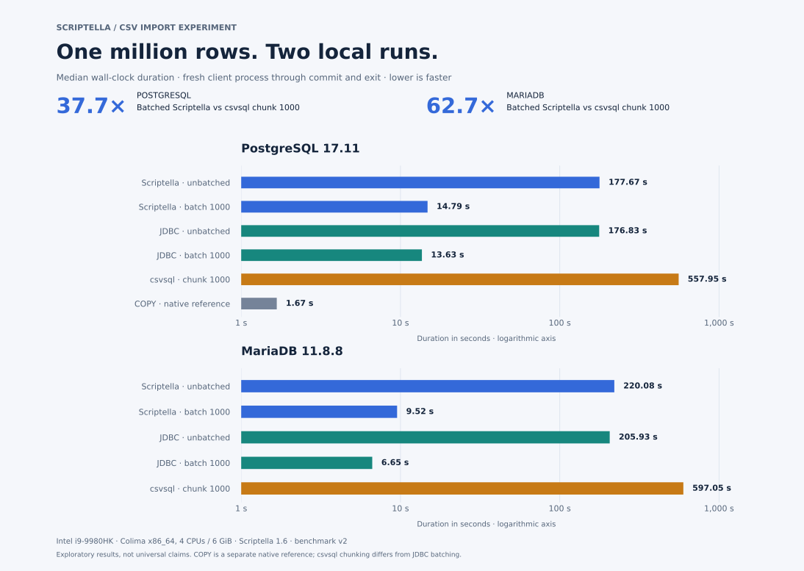

# Local CSV import results — 2026-10-12

Two complete, compatible runs imported the same million-row CSV through all
eleven cases. Every import passed independent row-count and first/middle/last
value checks before its timing was recorded. This is an exploratory engineering
experiment, not an industry-grade benchmark or a universal performance claim.



The chart uses a **logarithmic duration axis**; read the printed seconds for
absolute differences. Each value is the median of two observations, so it is the
midpoint of those two observations. Duration and throughput medians are computed
independently. The [full report](report.md) includes all individual values,
versions, sample counts, and ratios of median durations.

| Database | Scriptella batch 1000 | JDBC batch 1000 | csvsql chunk 1000 | Scriptella vs csvsql |
|---|---:|---:|---:|---:|
| PostgreSQL | 14.792 s | 13.631 s | 557.945 s | 37.7× |
| MariaDB | 9.523 s | 6.649 s | 597.053 s | 62.7× |

PostgreSQL native COPY took 1.672 s (median). It is a separate native database
reference, not a portable competitor or a performance ceiling. The Scriptella
speedup columns use `csvsql duration / Scriptella duration`; above 1 means
Scriptella is faster. JDBC was faster than batched Scriptella by about 8% on
PostgreSQL and 30% on MariaDB in terms of shorter duration.

## Environment and method

- Intel Core i9-9980HK at 2.40 GHz; macOS host with 32 GiB RAM.
- Docker via x86_64 Colima / macOS Virtualization.Framework, 4 CPUs and 6 GiB RAM.
- Scriptella 1.6 from Maven Central; Temurin Java 17.0.17+10; Python 3.12.3.
- PostgreSQL 17.11, MariaDB 11.8.8; normal durability and JDBC batch-driver defaults.
- Fixed case order, one transaction per import, and a 20,000-row untimed warmup
  followed by a fresh client process for the measured million rows.
- Timings include process startup, CSV conversion, connection, insertion, commit
  and cleanup; they exclude preparation, warmup, reset and verification.
- csvsql uses its documented default inference path and chunk size 1000. Its
  in-memory table preparation differs from Scriptella's streaming CSV path.

See the [main methodology](../../../README.md#measurement-method) and each run's
`preparation.properties` for the exact dependency versions and artifact checksums.
The raw CSV files and properties are preserved unchanged. `benchmark_revision=n/a`
reflects the original recordings before publication; benchmark v2 and the explicit
compatibility fields establish their comparison contract. No clean commit SHA
has been retroactively assigned to these runs.

## Coarse RAM observations

The first run included lightweight one-second process-memory sampling during the
MariaDB cases. Observed resident high-water marks were approximately **188 MiB
for batched Scriptella**, **146 MiB for batched JDBC**, and **895 MiB for csvsql**.
These are whole-process observations, not precise peak RAM, Java heap, database
RAM, or container totals. Polling can miss a peak near process exit. This is
article context that illustrates memory behavior, not a rigorous RAM comparison.

The curated [memory summary](memory-summary.md) explains collection limits.
Per-second samples and process logs remain in the local/private evidence archive.
Sampling started during MariaDB Scriptella unbatched, after PostgreSQL clients
had exited. A separate PostgreSQL csvsql snapshot observed about 886 MiB RSS,
which is not a peak. The second run had no memory sampler. Manual progress checks
and lightweight sampling were active during parts of the first exploratory run;
that difference is not encoded in the original CSV compatibility fields.

The maintainer described Scriptella's CSV import path as an initial implementation
that has not yet had a dedicated CSV-import performance optimization pass. These
results establish a starting point for future optimization, rather than an
optimized endpoint. The experiment itself did not tune JVM, database, driver,
chunk-size or importer internals.

## Reproduce the report and chart

From the repository root, regenerate the report using the command in
[the aggregation instructions](../../../README.md#aggregate-compatible-runs).
The optional chart generator needs matplotlib, independently of the benchmark:

```sh
python3 -m venv /tmp/scriptella-chart
/tmp/scriptella-chart/bin/pip install matplotlib==3.10.8
/tmp/scriptella-chart/bin/python tools/plot-results.py docs/results/2026-10-12-intel-i9
```

The generator reads the two unchanged `measurements.csv` files and writes an SVG
with selectable text, exact duration labels and an accessible description. The
optional PNG preview is for local inspection and is not published evidence.
