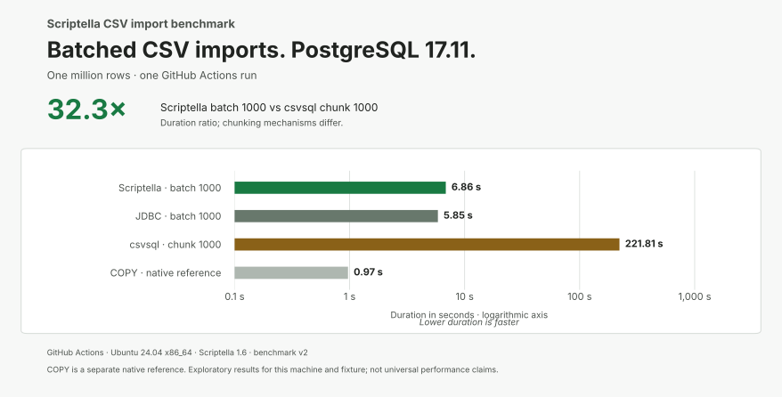
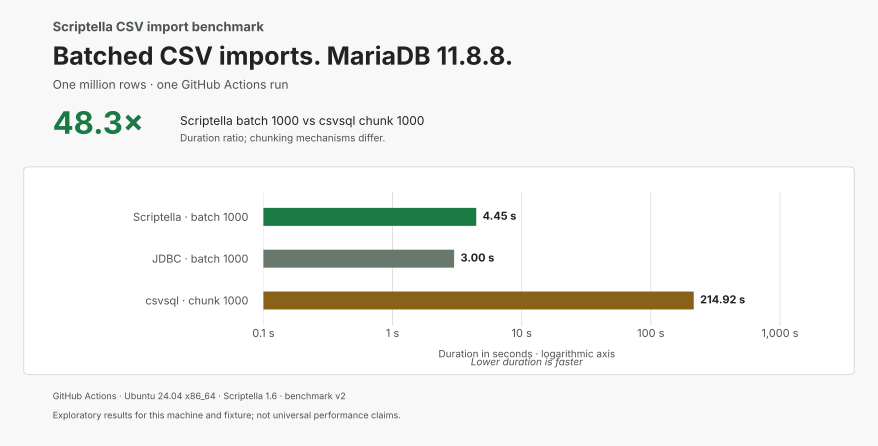

# GitHub Actions CSV import results — 2026-10-13 UTC

One full [manual workflow run](https://github.com/scriptella/scriptella-benchmarks/actions/runs/38330564796)
imported the million-row fixture through all eleven cases. Every import passed
independent row-count and first/middle/last value verification before its timing
was recorded. The workflow generated a report and uploaded its result artifact.





| Database | Scriptella batch 1000 | JDBC batch 1000 | csvsql chunk 1000 | Scriptella vs csvsql |
|---|---:|---:|---:|---:|
| PostgreSQL | 6.858 s | 5.854 s | 221.805 s | 32.3× |
| MariaDB | 4.446 s | 2.998 s | 214.924 s | 48.3× |

PostgreSQL native COPY took 0.968 s as a separate native reference. It is not a
portable competitor or a performance ceiling. Charts use a logarithmic duration
axis and print the exact rounded seconds. Speedup is `csvsql / Scriptella`.

## Environment and evidence

- GitHub-hosted `ubuntu-24.04` x86_64 runner, Docker Compose and JVM defaults.
- Environment ID: `gha-ubuntu-24.04-x64`; benchmark version: `v2`.
- Scriptella 1.6; Java 17.0.17+10; Python 3.12.3.
- PostgreSQL 17.11 and MariaDB 11.8.8, with normal durability and driver defaults.
- The same fixture hash, case order, transaction scope, warmup and timing boundary
  as the local experiment; see the [main methodology](../../../README.md#measurement-method).
- RAM was not measured. No local RAM observations are attributed to CI.

The [full report](report.md) includes all eleven durations, throughputs, ratios,
and compatibility metadata. The run directory contains the unchanged
`measurements.csv` and `preparation.properties` selected from artifact
`benchmark-38330564796-1` (artifact ID `11782653035`). Build/process logs are not
part of this curated publication. Its recorded revision is the publication
commit `e37996a`; later chart/documentation edits do not change the benchmark.

These are **one run**, not repeated CI medians. The generated report's median
columns equal the single observation. GitHub-hosted machines can vary between
executions; matching runner labels do not establish identical hardware. CI data
is kept separate from the local development-machine result set and must not be
pooled with it. Results are exploratory rather than universal performance claims.

## Regenerate report and charts

From the repository root:

```sh
docker compose run --build --no-deps --rm \
  -v "$PWD/docs/results/2026-10-13-ci:/results" benchmark aggregate /results
```

The optional chart tool uses matplotlib 3.10.8, as described in the
[local result notes](../2026-10-12-local/README.md#reproduce-the-report-and-chart):

```sh
python tools/plot-results.py docs/results/2026-10-13-ci
```
