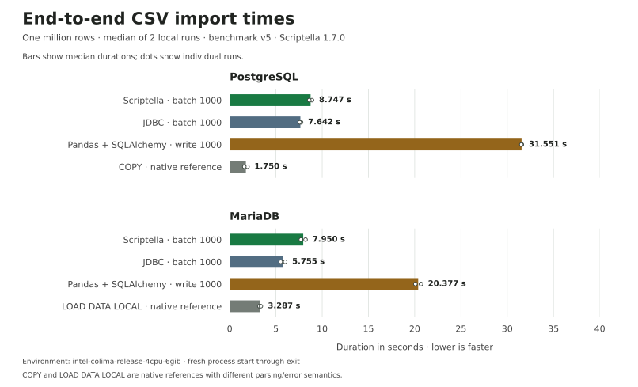

# Local CSV import results — benchmark v5

Two compatible eight-case runs on 2026-11-03, using Scriptella **1.7.0**.
These are the quoted v5 measurements. The chart reports end-to-end import
durations, not isolated SQL execution or ETL abstraction overhead.



Values are **median seconds (run 1, run 2)**. Scriptella and JDBC use batch 1000.

| Database | Scriptella | JDBC | Pandas + SQLAlchemy | Native load |
|---|---:|---:|---:|---:|
| PostgreSQL | 8.747 (8.893, 8.601) | 7.642 (7.716, 7.569) | 31.551 (31.578, 31.524) | COPY: 1.750 (1.921, 1.579) |
| MariaDB | 7.950 (8.200, 7.700) | 5.755 (5.998, 5.513) | 20.377 (20.076, 20.678) | LOAD DATA LOCAL: 3.287 (3.204, 3.370) |

| Database | Pandas / Scriptella | JDBC / Scriptella | Scriptella / native |
|---|---:|---:|---:|
| PostgreSQL | 3.607× | 0.874× | 4.998× |
| MariaDB | 2.563× | 0.724× | 2.419× |

Ratios use median durations. Pandas took longer than Scriptella on both
databases; JDBC was faster than Scriptella. Native loaders were fastest here.
Pandas remains a familiar portable reference. COPY and LOAD DATA LOCAL are
native bulk-loading references with different parsing and error semantics.
These observations do not establish a universal ranking.

The same VM and case definition were used for the
[Scriptella 1.6 and 1.7.0 comparison](../2026-11-03-release-comparison/README.md).
Earlier Scriptella 1.6 v5 runs from 2026-10-26 stay in
[2026-10-26-local-v5](../2026-10-26-local-v5/README.md).

## Environment and evidence

- Intel Mac x86_64; Colima VM, 4 CPUs / 6 GiB; JVM defaults. This allocation
  is the local reference setup for quoted comparisons.
- Environment ID: `intel-colima-release-4cpu-6gib`; benchmark version: `v5`.
- Case definition: `v5-final-eight-pg-rewrite-true-warmup20000-pandas-read10000-write1000-local-infile-v1`.
- Scriptella core/drivers 1.7.0; Java 17.0.17+10; Commons CSV 1.14.1.
- PostgreSQL 17.11, pgJDBC 42.7.13, `reWriteBatchedInserts=true` for both Java contenders.
- MariaDB 11.8.8, Connector/J 3.5.7; native loader sets `allowLocalInfile=true`.
- Python 3.12.3; Pandas 2.3.3; NumPy 2.3.4; SQLAlchemy 2.0.46;
  psycopg2-binary 2.9.11; PyMySQL 1.1.2.
- Source traceability: Git commit `80d95ef` plus the local `.dockerignore`
  fix, recorded as `80d95ef-plus-dockerignore`.

Raw measurements and preparation metadata retain the original timestamps,
version markers, fixture hash, dependency checksums and settings:

- [Run 1 measurements](run-20261103T195118Z-2b4c33da-d7ff-4529-a543-ced722a062e2/measurements.csv)
  and [metadata](run-20261103T195118Z-2b4c33da-d7ff-4529-a543-ced722a062e2/preparation.properties).
- [Run 2 measurements](run-20261103T195311Z-0306c6ec-8f2e-4e61-8dbe-917eeaa1ba71/measurements.csv)
  and [metadata](run-20261103T195311Z-0306c6ec-8f2e-4e61-8dbe-917eeaa1ba71/preparation.properties).
- [Generated aggregate](report.md): compatibility metadata, individual values,
  throughput and ratios. [Evidence checksums](SHA256SUMS).

## Method and correctness

Each run imports the unchanged deterministic million-row CSV into the shared
schema. A 2,001-row smoke checks all eight cases, and a verified 20,000-row warmup
precedes each measured import. Tables reset independently between imports.
Fresh process startup, parsing, conversion, database writes, commit and cleanup
are timed through successful exit. Preparation, warmup, reset and verification
are excluded. All sixteen measured imports passed independent JDBC count and
sample-value verification, including exact decimal amounts and UTC timestamps.

Pandas reads 10,000 rows at a time and uses default `to_sql` insertion with
1,000-row write chunks in one transaction. PostgreSQL COPY streams the same CSV.
MariaDB LOAD DATA LOCAL streams the fixture from the client, without a separate
file copy into the database container; it explicitly maps columns, UTF-8/LF
handling and the header. A pre-measurement InnoDB probe verified uncommitted
rows were invisible to another connection and rollback left the table empty.
The actual imports committed before independent verification.

Durability was not weakened for native loading: PostgreSQL synchronous_commit
and fsync are on; MariaDB innodb_flush_log_at_trx_commit is 1. MariaDB log_bin is
0, binlog_format is MIXED and sync_binlog is 0. LOCAL INFILE uses server parsing
and relaxes strict-mode handling; the client rejects load warnings. This does
not imply identical error, trigger, locking or replication semantics to batched
INSERTs. See the [benchmark guide](../../benchmark-guide.md#mariadb-native-load-data).

Only two sequential local runs were collected for these quoted figures. Fixed
order, cache state, process startup costs and host load affect the results.
Individual observations are plotted as dots, not confidence intervals. RAM and
swap were not measured.

## Reproduce the report and chart

Run from the benchmark repository root. The chart generator needs matplotlib
as an optional local plotting dependency; it is not a benchmark runtime dependency.
Both chart and report validate compatibility before aggregation. The checked-in
chart was rendered with Python 3.15 and matplotlib 3.11.2 in a separate temporary
plotting environment; measured benchmark runtime dependencies were unchanged.

```sh
docker compose run --no-deps --rm \
  -v "$PWD/docs/results/2026-11-03-local-v5:/results" benchmark aggregate /results
python3 tools/plot-overview.py docs/results/2026-11-03-local-v5
```

For the benchmark itself, follow the [smoke and full-run instructions](../../benchmark-guide.md)
on an x86_64 Colima VM with 4 CPUs and 6 GiB, using Scriptella 1.7.0.
Keep incompatible case definitions and other Scriptella releases in separate
aggregation directories.
